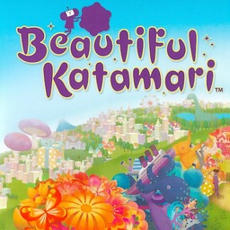

<div align=center>



</div>
<h1 align=center>Beautiful Katamari — Nintendo Switch port</h1>

A native Nintendo Switch port of the Xbox 360 version of **Beautiful Katamari** (Namco Bandai Games, 2007), with its
downloadable content.

It's not an emulator. The PowerPC code of the game's `default.xex` is statically recompiled to C++ with
[ReXGlue](https://github.com/rexglue/rexglue-sdk) and compiled for the Switch, and the game's Direct3D calls are drawn
directly on the Switch GPU's own API, deko3d, by [reNut](https://github.com/masterspike52/reNut)'s Direct3D-level renderer.

> [!NOTE]
> You need your own copy of the Xbox 360 disc (a disc image, `.iso`; the NTSC-U release). The DLC packages
> (`Content/<profile>/4E4D07DC/00000002`) are optional.

## How to install

1. Open the installer page: **https://chanseyisthebest.github.io/katamari-nx-installer/**
2. Choose your game: its **disc image** (`.iso`; you can choose the DLC package files along with it) or a **folder** you
   extracted the game into. Then press **Create katamari-nx.zip**. Everything runs in your browser and the game files
   never leave your computer: the page checks your copy, downloads the build and makes the shaders from your game's own
   files.
3. Extract the downloaded `katamari-nx.zip` into `sdmc:/switch/`.

Your `katamari-nx` folder should look like this:

```text
/switch/katamari-nx/
  katamari-nx.nro
  LICENSES.txt
  katamari.toml             (your settings; written at the first start when it is missing)
  deko3d_glsl.bin           (the game's shaders, made from your copy)
  game_root/                (the files of your disc)
  dlc/                      (optional: the DLC packages, installed by the game at its first start)
```

The game adds `deko3d_shaders.bin` and `pipeline_list.bin` there as you play (the shaders compiled for the Switch GPU, and
the list of what it drew, so later sessions prepare it ahead).

Launch it with a game override (hold **R** while starting an installed title) or a forwarder. Album applet mode does not
give the game enough memory. If you use a forwarder, set it to a **39-bit address space**.

To build everything yourself instead, see [docs/building.md](docs/building.md).

> [!NOTE]
> **Updating:** open the installer page again and press **Create katamari-nx-update.zip**. It only holds the new
> `katamari-nx.nro` and the shaders, so there is no need to copy the game again: extract it over your folder. Your
> `katamari.toml`, your saves and the game files stay.

> [!CAUTION]
> **The first time you play** after installing or updating, the game compiles its shaders for the Switch GPU as it meets
> them, so **IT CAN STUTTER for a moment** in new places. They are saved next to the NRO (`deko3d_shaders.bin`) and later
> sessions start smoothly.

## Controls

By default the face buttons work **by position, as on the Xbox 360 pad** the game was made for: the bottom button is the
Xbox's A, the right one is the Xbox's B, and so on.

<div align="center">

| Switch | Xbox 360 |
| --- | --- |
| B (bottom) | A |
| A (right) | B |
| Y (left) | X |
| X (top) | Y |
| ZR / ZL | RT / LT |
| R / L | RB / LB |
| + | Start |
| − | Back |
| Sticks / D-pad | Sticks / D-pad |

</div>

To use the buttons by letter instead (the Switch's A acts as A), set `input_xbox_layout = false` in `katamari.toml`.

**Two players:** every controller is its own player, in the order they connect. The console in handheld mode counts as
one, so handheld + a Pro Controller makes players 1 and 2. Single Joy-Cons are held sideways, one per player (SL and SR
are the triggers). **L + R + ZR** opens the system's controller screen to connect, reorder, or split a Joy-Con pair.

**Remapping:** each player has a button map in `katamari.toml` (`[input_p1]` and `[input_p2]`).

## Settings

`katamari.toml`, next to the NRO, holds only your options. Everything else is built into the NRO.

<div align="center">

| Setting | What it does |
| --- | --- |
| `msaa_level` | Samples per pixel of the game's edge smoothing: `4` (the game's own, default), `2` or `1` (off). Fewer gives rougher edges and less GPU work |
| `frame_cap` | Frame rate cap: `"Off"` (the game's own, uncapped as on the Xbox 360, default) or `"30"` |
| `user_language` | The game's language: `1` English (default), `2` Japanese |
| `katamari_dlc_unlock_packs` | Also load the DLC packs that only unlock what the game itself unlocks: Accessory Sets A-D, Character Sets A-D, Special Accessory (`false`, default). The stage packs always load |
| `input_xbox_layout` | Face buttons by position (`true`, default) or by letter (`false`) |
| `input_joycon_sideways` | Single Joy-Cons held sideways, one per player (`true`, default) |
| `input_joycon_sideways_stick` | With it, a single Joy-Con's stick turned for the sideways grip (`true`, default) |
| `[input_p1]`, `[input_p2]` | Each player's buttons: for every Xbox button, the Switch buttons that press it, e.g. `a = "B, ZR"` |

</div>

If you delete `katamari.toml`, the game writes the default one again at the next start.

## Performance

The port runs at the console's stock clocks on three cores, 720 lines in handheld and 1080 docked. The released NRO is
built with link-time optimisation and PGO from a console session of this version. The hub and the menus hold 60 fps; the
biggest stages drop well below that (19-47 fps in the last console profile before 1.0.0's optimisations of those stages:
[docs/console-rc9-breakdown.md](docs/console-rc9-breakdown.md)). Every optimisation was compared with the original
functions on the PC, call by call: the measurements are in [docs/katamari-notes.md](docs/katamari-notes.md).

## How it works

- **The game's code is translated, not emulated.** [ReXGlue](https://github.com/rexglue/rexglue-sdk) translates every
  function of the game's program to C++, which is then compiled for the Switch. ReXGlue also gives the game what it
  expects from an Xbox 360: its system, files, audio and controllers.
- **A Direct3D-level renderer on deko3d.** The game's Direct3D calls are replaced by
  [reNut](https://github.com/masterspike52/reNut)'s renderer (as the Banjo-Kazooie: Nuts & Bolts port adapted it), which
  draws them with [plume](https://github.com/renderbag/plume) on [deko3d](https://github.com/devkitPro/deko3d), the Switch
  GPU's own API: no GPU command stream is written or parsed and no EDRAM is modelled.
- **Shaders made from your copy.** Beautiful Katamari keeps its 195 shaders in `default.xex` and in the models of its data
  files. The installer page takes them from your copy and makes `deko3d_glsl.bin` in your browser: Renut's
  [XenosRecomp](https://github.com/hedge-dev/XenosRecomp) translates each one to HLSL, DXC compiles it to SPIR-V,
  [SPIRV-Cross](https://github.com/KhronosGroup/SPIRV-Cross) turns that into GLSL and banjo-nx's passes trim it. The console
  compiles each one with [uam](https://github.com/devkitPro/uam) the first time it is used and keeps the result. The NRO
  itself holds no shader of the game.
- **Hand-written and machine-optimised functions.** The game's hottest functions run as native ARM code written for them
  (`app/src/cpu/hot`), and 1,387 more as optimised machine copies; each one was checked against the generated original.

## Documentation

<div align="center">

| Document | What it explains |
| --- | --- |
| [docs/building.md](docs/building.md) | How to build the PC test build, the NRO and the shader files |
| [docs/katamari-notes.md](docs/katamari-notes.md) | The port step by step: findings in the game's code, every optimisation and how it was checked |
| [docs/optimising-functions.md](docs/optimising-functions.md) | How the game's functions are made faster: machine copies of as many as possible, hand-written ones only from console profiles |
| [docs/codegen-crash-fixes.md](docs/codegen-crash-fixes.md) | The code generation crashes found and how each was fixed |
| [docs/progress-log.md](docs/progress-log.md) | The work in order |

</div>

## Build

Windows, LLVM clang and the VS Build Tools for the PC build; devkitA64, libnx and deko3d from
[devkitPro](https://devkitpro.org) for the Switch; Python; and your own copy of the game for the code generator and the
shaders. The whole process is in [docs/building.md](docs/building.md).

<div align="center">

| Folder | Contents |
| --- | --- |
| `app/` | The game: hooks, renderer, native functions, settings, CMake project |
| `sdk/` | ReXGlue SDK with the Horizon layer and the code generator changes |
| `tools/` | Code generation steps, build and test scripts, shader tools, analysis tools |
| `pgo/` | The PGO profile the released NRO was built with (counts of which code ran, no game code or data) |
| `dist/` | The settings of the test builds |
| `docs/` | Documentation |

</div>

## Credits

- **Namco Bandai Games** — creators of Beautiful Katamari. This is an unofficial, fan-made port with no affiliation.
- **ChanseyIsTheBest** — this port.
- **[Tom Clay](https://github.com/rexglue/rexglue-sdk)** — the ReXGlue SDK, built on the work of the
  **[Xenia](https://xenia.jp)** team.
- **[StevensND](https://github.com/StevensND/nfsmw-nx)** — nfsmw-nx: the Switch layer of the SDK and much of the method;
  and [nfsmw-nx-installer](https://github.com/StevensND/nfsmw-nx-installer), the installer page this port's is built on.
- **[nebadasSwifty](https://github.com/nebadasSwifty/masseffect-nx)** — masseffect-nx.
- **[hedge-dev](https://github.com/hedge-dev/XenosRecomp)** — XenosRecomp, the Xenos shader translator.
- **reNut and [masterspike52](https://github.com/masterspike52/reNut)** — reNut's Direct3D-level renderer (reused with its
  author's permission).
- **[plume](https://github.com/renderbag/plume)** (from UnleashedRecomp), **[deko3d](https://github.com/devkitPro/deko3d)**
  and **[uam](https://github.com/devkitPro/uam)** by fincs, with SwitchWakerHD's uam patches.
- **[devkitPro](https://devkitpro.org) and [switchbrew](https://github.com/switchbrew/libnx)** — devkitA64 and libnx.
- The sibling ports ([renut-nx](https://github.com/ChanseyIsTheBest/renut-nx), this port's base;
  [sa2-nx](https://github.com/ChanseyIsTheBest/sa2-nx), [futari-nx](https://github.com/ChanseyIsTheBest/futari-nx), Peggle 2,
  Sonic & All-Stars Racing Transformed), which share their fixes with this one.
- **[KhronosGroup](https://github.com/KhronosGroup/SPIRV-Cross)** — SPIRV-Cross.
- The other libraries listed in [THIRD_PARTY_NOTICES.md](THIRD_PARTY_NOTICES.md).

## Legal

No affiliation with Bandai Namco, Microsoft or Nintendo. "Beautiful Katamari" is a trademark of Bandai Namco
Entertainment; the icon is its cover artwork. This repository contains no game files and no code generated from the game.
Users must provide their own legally obtained copy, and everything made from it (`app/generated/`, the shaders) is made on
their own computer. Running homebrew requires custom firmware, which violates Nintendo's ToS and can get a console banned
— your call.

Source code is provided under the GPL-3.0 License (see [LICENSE](LICENSE)), like the ports it builds on. The SDK keeps its
BSD-3-Clause license (see [THIRD_PARTY_NOTICES.md](THIRD_PARTY_NOTICES.md)).
