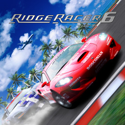

<h1 align=center>Ridge Racer 6: Nintendo Switch port</h1>

A port of the Xbox 360 game **Ridge Racer 6** (Namco, 2005) to the Nintendo Switch, with a PC build as the step on the way.

It's not an emulator. The PowerPC code of the game's `default.xex` is statically recompiled to C++ with
[ReXGlue](https://github.com/rexglue/rexglue-sdk), and the game's Direct3D calls are drawn by
[reNut](https://github.com/masterspike52/reNut)'s Direct3D-level renderer, on the Switch GPU's own API, deko3d.

> [!NOTE]
> You need your own copy of the Xbox 360 disc. The DLC packs are optional. Game data is never part of this repository or
> its packages.

## How to install

1. Open the installer page: **https://chanseyisthebest.github.io/rr6-nx-installer/**
2. Choose your game (the disc image or an extracted folder), then any DLC packages, and press **Create rr6-nx.zip**.
   Everything runs in your browser and your game files stay on your computer. The game files are packed on the way: LZ4
   for the three RRM archives, ZXC for the videos, the music and the sounds (about 800 MB smaller on the SD card).
3. If you have an older rr6-nx, delete its `switch/rr6-nx/game_root` folder. Then extract `rr6-nx.zip` to the root of
   your SD card. It makes `switch/rr6-nx/`.
4. In **Sphaira**, find Ridge Racer 6, press **X**, choose **Install Forwarder**, set **Address Space** to **39-bit**,
   choose **Create Forwarder**, and start the game from the Home Screen.

Your options are in `switch/rr6-nx/config.toml`, with a comment on each: the language (by default the Switch's), SMAA,
the game's MSAA, rumble, the DLC's car Unlock Keys and each player's buttons. Every other setting is built into the NRO
(`app/rr6_switch_defaults.toml`). Multi Battle works with a second controller. Crash logs go to `switch/rr6-nx/logs/`.

The release NRO is built with link-time optimisation and a profile (PGO) collected from a play session.
`docs/progress-log.md` has the work in order, and `docs/rr6-notes.md` the evidence and the visual differences still
open.

## Documentation

| File | What it holds |
|---|---|
| `docs/rr6-notes.md` | This game: decisions, code generation, game fixes, Renut at XDK 2.0.2135, visual differences |
| `docs/progress-log.md` | The work in order |
| `docs/building.md` | How to build (written for katamari-nx; its game-specific file names are still to be updated) |
| `docs/optimising-functions.md` | The hot-function method |
| `docs/from-katamari/` | The notes of the port this one started from |

## Credits

- **Ridge Racer 6 Recomp** by Sirhalo23 (BSD 3-Clause, `docs/licenses/`): its codegen work and its notes on this game.
- **reNut** by masterspike52: the renderer. Its author permits reuse in these ports.
- **katamari-nx**, the port this tree was copied from, and **banjo-nx**, the renderer's adaptation and the method docs.
- **sa2-nx**, **NetherSX2_nx**, **battd_nx**, **bejeweled3-nx** and the **Zuma** ports.

`THIRD_PARTY_NOTICES.md` has the full list and each project's license. GPL-3.0 where the sources are (`LICENSE`).

Ridge Racer is a trademark of Bandai Namco Entertainment; the icon artwork is © Bandai Namco Entertainment. This project
is not affiliated with or endorsed by Bandai Namco or Nintendo.
