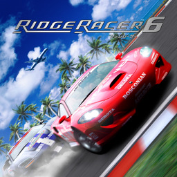

<h1 align=center>Ridge Racer 6: Nintendo Switch port</h1>

<b>rr6-nx 1.0.2.1</b> · <a href="https://chanseyisthebest.github.io/rr6-nx-installer/">web installer</a> · <a href="https://github.com/ChanseyIsTheBest/rr6-nx/releases/tag/v1.0.2.1">release</a>

An unofficial native port of the Xbox 360 game **Ridge Racer 6** (Namco, 2005), made by static recompilation with
[ReXGlue](https://github.com/rexglue/rexglue-sdk) and drawn by [reNut](https://github.com/masterspike52/reNut)'s
renderer on deko3d. No emulator. There is a PC build too.

This repository contains no game files. You need your own copy of the game: the Xbox 360 disc (the DLC packs are
optional).

## Playing it on the Switch

1. Open the web installer: **https://chanseyisthebest.github.io/rr6-nx-installer/**
2. Choose your game (the disc image or an extracted folder), then any DLC packages, and press **Create rr6-nx.zip**.
   It runs in your browser; your game files stay on your computer.
3. Extract `rr6-nx.zip` to the root of your SD card.
4. In **Sphaira**, find Ridge Racer 6, press **X**, choose **Install Forwarder**, set **Address Space** to **39-bit**,
   choose **Create Forwarder**, and start the game from the Home Screen.

**Updating from 1.0.2:** replace `switch/rr6-nx/rr6-nx.nro` with the one from the
[releases page](https://github.com/ChanseyIsTheBest/rr6-nx/releases) and keep everything else. From an older rr6-nx,
delete `switch/rr6-nx/game_root` and `switch/rr6-nx/dlc` (and `switch/rr6-nx/renut/0000000000000000` if you had the
DLC with 1.0.1), then follow the steps above.

- **Keep `switch/rr6-nx/renut/B13EBABEBABEBABE`: it holds your save.**
- The NRO alone does not run: the game's shaders are the installer's files next to it.

Features:

- Multi Battle with a second controller.
- Game menu (A+B+X+Y+L+R): language (the Switch's by default), SMAA, the game's MSAA, rumble, the DLC's car Unlock Keys
  and each player's buttons, saved to `switch/rr6-nx/config.toml`. Everything else is built into the NRO
  (`app/rr6_switch_defaults.toml`).
- Dynamic resolution docked (972p-1080p); 720p handheld.
- Shaders made and compiled for the Switch by the installer, so no compile stutters.
- About 3.4 GB on the SD card instead of the disc's 6.2 GB (packed game files, Opus music, H.265 movies).
- Logging off except crash logs (`switch/rr6-nx/logs/`). For a bug report, add `log_level = "info"` at the top of
  `config.toml` and send the `logs/` folder.

## Building

- [docs/building.md](docs/building.md): how to build (written for katamari-nx; its game-specific file names are still
  to be updated).
- [docs/rr6-notes.md](docs/rr6-notes.md): this game's decisions, code generation, fixes and open visual differences.
- [docs/progress-log.md](docs/progress-log.md): the work in order.
- [docs/optimising-functions.md](docs/optimising-functions.md): the hot-function method.
- [docs/from-katamari/](docs/from-katamari/): the notes of the port this one started from.

## Credits and license

- **Ridge Racer 6 Recomp** by Sirhalo23 (BSD 3-Clause, [docs/licenses/](docs/licenses/)): its codegen work and its notes
  on this game.
- **reNut** by masterspike52: the renderer. Its author permits reuse in these ports.
- **katamari-nx**, the port this tree was copied from, and **banjo-nx**, the renderer's adaptation and the method docs.
- **sa2-nx**, **NetherSX2_nx**, **battd_nx**, **bejeweled3-nx** and the **Zuma** ports.

[THIRD_PARTY_NOTICES.md](THIRD_PARTY_NOTICES.md) has the full list and each project's license. GPL-3.0 where the sources
are ([LICENSE](LICENSE)).

Ridge Racer is a trademark of Bandai Namco Entertainment; the icon artwork is © Bandai Namco Entertainment. This project
is not affiliated with or endorsed by Bandai Namco or Nintendo.
